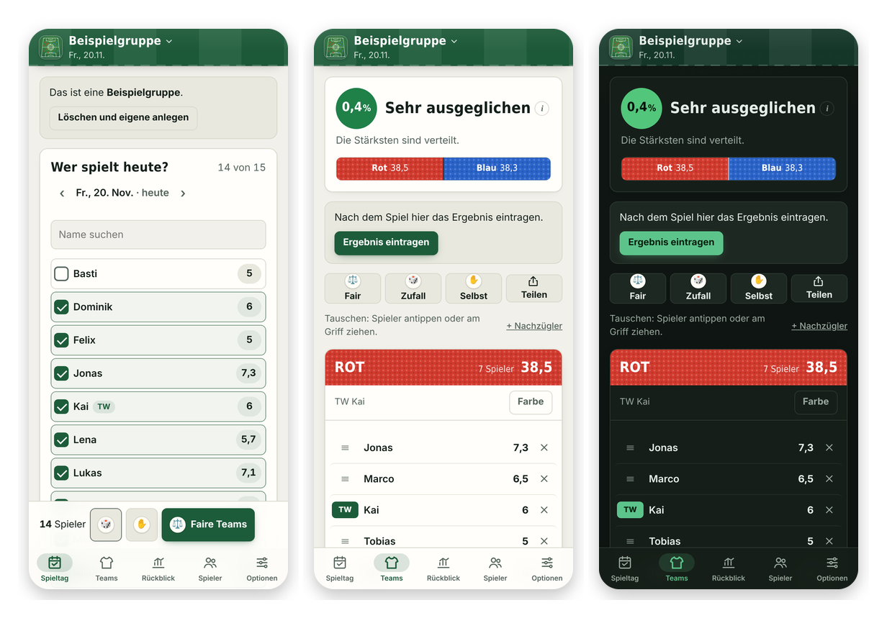

  

<h1 align="center">Faire Teams – Fußball</h1>

  <strong>Gleich starke Teams in Sekunden – Schluss mit 10:1.</strong> 
  Für Hobbyrunden, Betriebssport und Vereine. Kostenlos, ohne Anmeldung, alles bleibt auf deinem Gerät.

  <a href="https://peter-unruh.github.io/fussball-team-generator/"><strong>▶ App im Browser öffnen</strong></a>

  

---

## So geht's

1. **Namen eintragen** – gern mit einer Stärke von 1 bis 10 (5–6 = Durchschnitt).
2. **Ankreuzen, wer heute da ist.**
3. **„Faire Teams“ tippen** – fertig. Spieler lassen sich danach noch per Antippen oder Ziehen tauschen.

Zum Reinschnuppern gibt es eine **Beispielgruppe** („Erst mal ausprobieren“).

## Was die App kann

- **Faire Einteilung** auf Knopfdruck – oder per Zufall oder selbst (Kapitäne wählen)
- **Stärke 1–10** oder genauer nach Technik, Kondition, Defensive, Offensive und mehr
- **Torhüter und Positionen** werden bei der Verteilung berücksichtigt – mit **Aufstellung auf dem Spielfeld** je Team
- **2 oder mehr Teams** mit eigenen **Namen und Farben**, Nachzügler lassen sich nachträglich einbauen
- **Paarregeln**, z. B. zwei Spieler immer zusammen oder immer getrennt
- **Ergebnisse eintragen** – der Rückblick lernt daraus und schätzt Stärken mit der Zeit genauer
- **Orte, Felder und Wetter** pro Spieltag – mit Hinweis, wenn es vor Spielende dunkel wird
- **Spielerliste aus Screenshots einlesen**, z. B. aus einer WhatsApp-Gruppe oder -Umfrage
- **Spieler von der Gruppe bewerten lassen:** Link verschicken, Mitspieler schätzen alle ein (mit Reihenfolge-Check) und schicken einen kurzen Code zurück – du siehst die Gruppenmeinung neben deiner Bewertung und übernimmst, was passt. Geht auch reihum auf einem Handy
- **Gast-Link für die Gruppe:** Bist du mal nicht da, bildet die Gruppe mit einem Link selbst faire Teams – ohne die Bewertungen zu sehen. Ergebnisse kommen als Code zu dir zurück
- **Teams teilen** per WhatsApp & Co. – mit Uhrzeit, Ort, Karte, Wetter und Kalender-Link, auch als Bild
- **Mehrere Gruppen** (Projekte), **Sicherung als Datei** und **Export als Tabelle (CSV)**
- Fürs Handy gemacht, mit **hellem und dunklem Design** – und **startet auch ohne Empfang** am Platz

## Auf dem Handy wie eine App nutzen

Link im Browser öffnen und dann:

- **iPhone (Safari):** Teilen-Symbol → „Zum Home-Bildschirm“
- **Android (Chrome):** Menü ⋮ → „Zum Startbildschirm hinzufügen“ bzw. „App installieren“
- **Computer (Chrome/Edge):** Installieren-Symbol in der Adressleiste – oder Edge: … → „Apps“ → „Diese Website als App installieren“

Im privaten Fenster (Inkognito/InPrivate) bieten die Browser das nicht an.

Die App erscheint dann mit eigenem Symbol auf dem Startbildschirm.

## Datenschutz

- **Kein Konto, keine Werbung, kein Tracking** – deine Daten liegen auf keinem Server.
- Alle Spieler, Ergebnisse und Einstellungen werden **nur im Browser auf deinem Gerät** gespeichert.
- Nur wenn du bestimmte Zusatzfunktionen nutzt, fragt die App externe Dienste an:
  - **Ortssuche und Wetter:** [Open-Meteo](https://open-meteo.com), [Photon (Komoot)](https://photon.komoot.io) und [OpenStreetMap Nominatim](https://nominatim.openstreetmap.org)
  - **Screenshots einlesen:** Die Texterkennung [Tesseract.js](https://tesseract.projectnaptha.com) wird in einer festen, geprüften Version von jsDelivr geladen – die Bilder selbst werden auf deinem Gerät ausgewertet.
  - **Karten-Links** öffnen Google Maps.
- **Gast-Link:** Im Link stecken je Spieler nur Name, Stärke und Torwart-Angaben. Angezeigt werden die Werte beim Empfänger nicht – sie sind aber nur versteckt, nicht verschlüsselt. Teile den Link deshalb nur mit deiner Gruppe.
- **Bewertungs-Umfrage:** Die Spielernamen stecken nur im Link (hinter dem #, das wird nie an einen Server geschickt). Die Antworten schicken die Mitspieler selbst per Nachricht zurück – am besten privat an dich, nicht in die Gruppe; dann siehst nur du die Einzelwerte.

> **Tipp:** Weil alles lokal gespeichert ist, sind deine Daten an Gerät und Browser gebunden. Du kannst in der App jederzeit eine **Sicherungsdatei** herunterladen – damit ziehst du auf ein neues Handy um oder teilst die Gruppe mit einem Mitspieler.

## Ohne Internet / als Datei

Wer die App einmal über den Link geöffnet hat, kann sie danach auch **ohne Empfang** starten – der Browser hat sie gespeichert ([`sw.js`](sw.js)). Gibt es eine neue Version, meldet sich die App.

Die ganze App steckt in einer einzigen Datei: [`index.html`](index.html). Du kannst sie herunterladen und direkt im Browser öffnen – sie funktioniert auch ohne diese Webseite (dann ohne Bilder aus `assets/` und ohne Installation als App).

## Lizenz

© 2026 Peter Unruh · [MIT-Lizenz](LICENSE) – frei nutzbar, veränderbar und weitergebbar.
